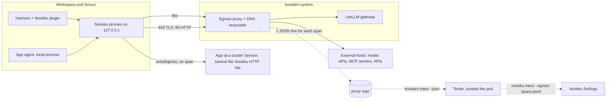

# Koodam with Nookku

Nookku tests an app agent. It runs as a plugin of the harness (Claude Code or Codex). Koodam gives the harness a Workspace pod on Kubernetes. This page gives the design of the 2 tools together, and the contracts between them.

> Status: v0.3 design, in build. The issues are #142, #143, #144, #145, #146, #165, #166 and #168. Each contract below names its issue. Do not use a part before its issue is merged.

## The parts



- **Nookku** starts 1 local proxy on 127.0.0.1 for each egress part of the app agent: the model API, the backends, the MCP servers and the databases. Nookku records the calls on these proxies.
- **Koodam** sends all egress of the pod through the egress proxy. The proxy writes 1 span for each call. Nookku reads the spans as a second record, and finds the calls that did not go through a Nookku proxy.
- The 2 records do not depend on each other. Nookku runs without Koodam. Koodam runs without Nookku.

## Who builds what (v0.3)

| Item | Koodam issue | What Koodam gives |
|---|---|---|
| K1 | #146, #168 | This page, with the Workspace setup for Nookku. No CRD field. |
| K2 | #168, #144 | The span contract v2 (`"v": 2`, `port`, `claimed`, #170) and `koodam trace --until`. |
| K3 | #143 | `workspace.networkPolicy.extraEgress` stays when the egress proxy is on. |
| K4 | #145 | 3 e2e cases: loopback, an `extraEgress` Service, a blocked port. |

The Nookku side (Nookku 0.5.6): the test folder from `NOOKKU_TESTS_DIR`, a kind proof of the HTTP tap, the gateway spend logs as a source, and `nookku trace --egress`. The proof of Nookku inside a Workspace comes in Nookku 0.6.0, after #142 and #143 merge.

The Nookku plugin preset of #83 is not in v0.3.

## Contract 1: the span

[egress-spans.md](egress-spans.md) is the contract. The parts that Nookku uses:

- Each line has `"v": 2`. A line with no `v` is version 1. Version 2 has no claim values and no `http` path (#170). Ignore the fields that you do not know.
- Match a span to a test by `time` and by `workspace` or `agent`. Match the target by `host`, `sni` and `port`.
- `result` is `ok`, `denied` or `error`.
- A TLS call gives 1 span for each connection, not for each request. Thus match by host, not by call.
- The model calls of a Workspace with a gateway key have the kind `llm`, and the `host` is the gateway. With a subscription login, the model API is a `connect` or `tls` span to the model host.

## Contract 2: koodam trace

From #144. Run it outside the Workspace pod, with your own kubeconfig:

```sh
koodam trace WORKSPACE --json --since 2026-10-23T09:00:00Z --until 2026-10-23T10:00:00Z > spans.jsonl
nookku trace --egress spans.jsonl
```

- `--json` prints the span lines without change.
- A span is in the window if `since <= time < until`.
- The command reads `pods/log` of the proxy pods. Your account needs that RBAC. The Workspace ServiceAccount does not get it, because the spans of 1 namespace can show the calls of other users.

## Contract 3: the network of a Workspace pod

When the chart has `egressProxy.enabled` (#142, #143, #165, #166):

| Call from the pod | Result | Span |
|---|---|---|
| 127.0.0.1 or `localhost` in the pod | Direct. The Nookku proxies work. | No |
| A model call to `ANTHROPIC_BASE_URL` or `OPENAI_BASE_URL` (a gateway key) | Through `http://<proxy>:3128/llm` to the gateway. | `llm` |
| An external name on 443 with TLS and an SNI | Through the proxy, if the name resolves to a public address. | `tls` |
| An external name on 80 with HTTP | Through the proxy, if the name resolves to a public address. | `http` |
| An external name on another port, for example Postgres on 5432 | Fails. | No |
| TLS without an SNI | Fails. | `denied` |
| A name in the cluster domain, for example `toy-shop.shop.svc` | Resolves. It connects only if a rule in `extraEgress` permits it. | No |
| The Kubernetes API server | Direct. | No |
| A direct connection to an external IP, or any IPv6 address | Fails. The NetworkPolicy permits no such path. | No |
| HTTPS to a public IP literal through `HTTPS_PROXY` | Through the proxy. | `connect` |
| DNS over HTTPS, for example to `dns.google` | Through the proxy, as for each HTTPS call. The proxy does not decrypt it. | `tls` with the DoH host |

How the steering works:

1. The controller sets `dnsPolicy: None` on the pod. The nameserver is the DNS responder in the proxy.
2. The responder sends a name in the cluster domain to kube-dns. It answers each other name with the proxy address, and it never sends that name upstream.
3. The proxy reads the SNI (443) or the `Host` header (80). It resolves the name again, checks that the address is public, and connects.
4. The proxy does not decrypt TLS. Koodam adds no CA to the pod.

The controller owns `dnsPolicy` and `dnsConfig` of the pod when the egress proxy is on. A value in `podTemplate` does not apply.

## Contract 4: the Workspace setup (K1)

Nookku needs no CRD field.

**Step 1. Set the variables in the login shell.** sshd does not give the container environment to an SSH session. Thus a harness that you start over SSH or in tmux does not get the `env` of `podTemplate`. Add the variables to a profile in the home, because the home stays on its PVC:

```sh
cat >> ~/.profile <<'EOF'
export CLAUDE_CODE_DISABLE_TERMINAL_TITLE=1
export NOOKKU_TESTS_DIR=/tests
EOF
```

For an Agent run, the harness is the main process of the pod. Thus for an Agent, set the 2 variables in the `env` of `spec.podTemplate`.

**Step 2. Add a volume for the tests.** Use `spec.podTemplate` ([workspaces.md](workspaces.md)):

```yaml
apiVersion: core.koodam.dev/v1alpha1
kind: Workspace
metadata:
  name: dev
  namespace: dev
spec:
  podTemplate:
    spec:
      containers:
        - name: workspace
          volumeMounts:
            - name: nookku-tests
              mountPath: /tests
      volumes:
        - name: nookku-tests
          persistentVolumeClaim:
            claimName: dev-nookku-tests
```

- Make the PVC `dev-nookku-tests` first. The tests then stay after the pod stops.
- The home of the Workspace (`/home/dev`) is also on a PVC. If you do not need a separate volume, skip step 2, and set `NOOKKU_TESTS_DIR` to a folder in the home.
- Install the Nookku plugin in the harness as usual. The home keeps it.

For an app at a cluster Service, permit it in the chart values:

```yaml
workspace:
  networkPolicy:
    extraEgress:
      - to:
          - namespaceSelector:
              matchLabels:
                kubernetes.io/metadata.name: shop
            podSelector:
              matchLabels:
                app: toy-shop
        ports:
          - protocol: TCP
            port: 8080
```

This traffic goes direct, so it has no span. The Nookku HTTP tap records it.

## Contract 5: the gateway

- An Agent run gets 1 gateway key. The alias is `kd-<agent uid>`, in `status.keyAlias`.
- A Workspace with a gateway key gets the alias `ws-<namespace>-<name>-<hash>`, in `status.keyAlias`.
- A Workspace with a subscription login has no gateway key.
- LiteLLM keeps the spend logs for each key alias. Koodam never writes the key value to a status, an event or a log. A span holds no header, no query string and no `http` path. The pod chooses only the host, the SNI and the `llm` path ([egress-spans.md](egress-spans.md), #170).
- Koodam gives no key for each Nookku test in v0.3. That needs a new API. Match the spend logs to a test by the time window and the key alias.

## Limits

- A span is metadata. It has no request inside a TLS tunnel.
- The proxy does not block DNS over HTTPS or other tunnels inside an HTTPS call. It records the host of each.
- The `extraEgress` traffic, the API server traffic and the loopback traffic have no span.
- An external database, or an app at a private address outside `extraEgress`, does not work in a Workspace with the egress proxy.
- The pod has no IPv6 egress.
